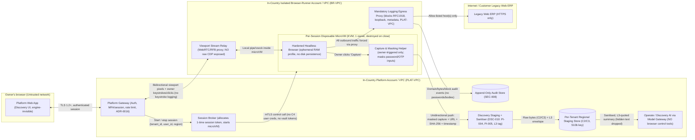

# Isolated browser runner architecture (Tier 5 connector)

Status: draft (accompanies Proposed [ADR-0052](../decisions/ADR-0052-isolated-browser-runner-placement.md))
Owner: partner

Plan IDs: INF-009 (placement decision), SEC-015 (egress and credential controls), DSC-017 (Discovery Tier 5 session). Nothing here is built; this document defines the target trust boundaries and data flows before `SEC-015` implementation begins.

## 1. Placement and trust boundaries

Each active operating market region (KSA, UAE, Egypt, Qatar per [ADR-0024](../decisions/ADR-0024-four-phase-1-markets.md) and [hosting-rules.md](../security/hosting-rules.md)) deploys an **isolated browser-runner cloud account/project and VPC** (`BR-VPC`), provisioned from the same IaC module with scale-to-zero / on-demand compute and **zero network route and zero IAM trust** into the main platform/ERP VPC (`PLAT-VPC`).

## 2. Boundary invariants

| Boundary | Rule | Enforced by |
|---|---|---|
| Owner UI <-> Gateway | Owner authenticates to the platform web app (`ADR-0016` branding; no vendor or engine markers). No raw Chrome DevTools Protocol (CDP) port or WebSocket is ever exposed to the client or to any AI agent (`PI-020`). | Platform Gateway + `STREAM` relay |
| `PLAT-VPC` <-> `BR-VPC` | Separate cloud account/project and VPC per active region. `BR-VPC` has **zero network route** to the ERP engine, Redis, MariaDB, `SecretStore`, ZATCA KMS keys, or control-plane DB (`PI-021`). Communication crosses only two narrow mTLS endpoints: (1) `CTL` lifecycle start/teardown and (2) unidirectional `CAP -> DSC` capture push. | Cloud IAM, VPC peering/firewall absence, mTLS (`S03`) |
| MicroVM <-> Host node | One disposable hardware-virtualised microVM per session (`PI-021`). Dedicated guest kernel over KVM; host node IAM role holds zero tenant or vault permissions. Rootfs is read-only; ephemeral overlay lives in RAM and is shredded/destroyed when the session closes or hits TTL. | Hypervisor (Firecracker/Kata class) + lifecycle controller |
| MicroVM <-> Internet | All egress routes exclusively through `PROXY` (`PI-022`). Direct socket egress from the microVM is blocked by host firewall/iptables/network namespace. `PROXY` resolves DNS itself, blocks RFC 1918, loopback (`127.0.0.0/8`, `::1`), link-local/cloud metadata (`169.254.169.254`, `fd00:ec2::254`), and platform CIDRs, re-validates on HTTP redirects (`T18`), and permits only HTTPS to the session's allow-listed origin(s). | Network namespace + logging egress proxy (`SEC-015`) |
| `CAP` -> `DSC` | Triggered only by explicit owner action (`PI-020`). Before leaving the microVM, `CAP` masks `<input type="password">`, OTP/card fields, and strips `Authorization` / `Cookie` / `Set-Cookie` headers (`PI-023`). `DSC` attaches `trust: "untrusted"` (L3), SHA-256 hash, timestamp, and URL (`PI-024`), runs `PI-004` / `PI-005` sanitisation (dropping hidden text), and stores raw evidence in `STG` under the tenant's regional `S10b` key. | `CAP` helper + `DSC-010` boundary |
| AI / Model Gateway | Models never hold navigate, click, type, or download tools (`PI-020`), never see raw C4 credentials (`PI-023`), and receive only L3-quoted, sanitised capture summaries (`A16`). | Tool API / `OPR-004` + Model Gateway (`PLT-009`) |

## 3. Session lifecycle

1. **Pre-session check (`DSC-017`):** Tiers 1–4 are confirmed inapplicable. Owner reviews notice/attestation (scope, read-only intent, no credential storage, ToS note per `T22`/`R-028`) and starts a session in their tenant's region.
2. **Provisioning (`CTL`):** `CTL` verifies owner role and tenant region, creates a one-time session ID, and requests a fresh microVM in that region's `BR-VPC` with a hard max session TTL and idle timeout.
3. **Authentication (Owner-driven):** Owner types URL, username, password, and MFA/OTP directly into the streamed viewport. Credentials reside solely in volatile browser memory inside that single microVM; neither the platform gateway, `CTL`, `CAP`, nor any log records keystrokes or password fields.
4. **Capture:** Owner navigates to the target ERP pages (chart of accounts, customer/supplier list, invoice layout) and triggers capture. Each capture is masked (`PI-023`), hashed, tagged L3 (`PI-024`), and pushed to `DSC` staging in the tenant's region (`STG`).
5. **Teardown:** On owner close, idle timeout, max TTL, or anomalous egress alert, `CTL` destroys the microVM, zeros/discards ephemeral RAM/tmpfs state, revokes the session token, and emits `meter.connector_run` plus audit metadata (`tenant_id`, `user_id`, `session_id`, region, start/end times, capture hashes, proxy domain/block counts — zero credentials).

## 4. Cross-references

- Decision record: [ADR-0052](../decisions/ADR-0052-isolated-browser-runner-placement.md)
- Tenancy and residency: [ADR-0006](../decisions/ADR-0006-tenancy-site-per-tenant.md), [ADR-0024](../decisions/ADR-0024-four-phase-1-markets.md), [hosting-rules.md](../security/hosting-rules.md), [data-classification.md](../security/data-classification.md)
- Prompt-injection and threat controls: [prompt-injection-defence.md](../security/prompt-injection-defence.md) (`PI-020`–`PI-024`, `A16`), [threat-model.md](../security/threat-model.md) (`T18`, `T22`)
- Connector specification: [connector-interface.md](../../contracts/connector-interface.md)
